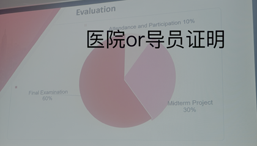

# 跨文化交际导论（英）

**待考据 · 史兴松**

[✏️ 编辑本页信息](/notebook-admin/public/offering/13)

| 字段 | 内容 |
|------|------|
| 课程代码 | ENG817 |
| 课程类别 | 基础选修 |
| 任课教师 | 史兴松 |
| 学期 | 待考据 |
| 开课学院 | 英语学院 |
| 总课时 / 周课时 | 32 / 待补充 |
| 教学周数 | 16 |

[← 返回课程总览](index.md)

## 考核方式

平时-10%，期中-30%（其实没有期中考试，我感觉这部分主要是小组pre），期末-60%（闭卷考试、结课周考试）

---

*最后更新：2026-06-17 · 信息来源：2023 级培养方案*
