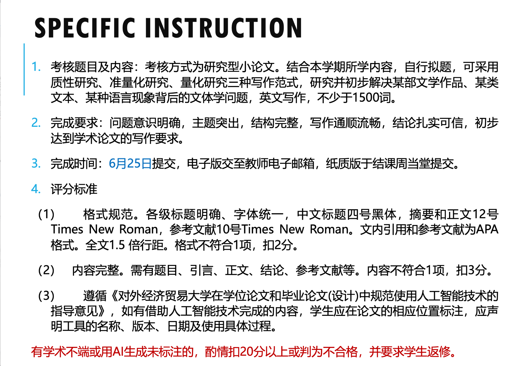

# 英语文体学

**2025-2026-1 · 李若珊**

| 字段 | 内容 |
|------|------|
| 课程代码 | ENG366 |
| 课程类别 | 专业方向课 |
| 任课教师 | 李若珊 |
| 学期 | 2025-2026-1 |
| 开课学院 | 英语学院 |
| 总课时 / 周课时 | 32 / 2 |
| 教学周数 | 16 |

## 考核方式

无期中，有一次pre，内容为当周讲解内容，可见教学进度

期末论文要求

## 教材及参考资料

- [参考书] 文体学  BY 文旭，宋成方

## 留言

---

*最后更新：2026-11-18 · 信息来源：2023 级培养方案*

[✏️ 编辑本页信息](/notebook-admin/public/offering/9){: .edit-page-link }
