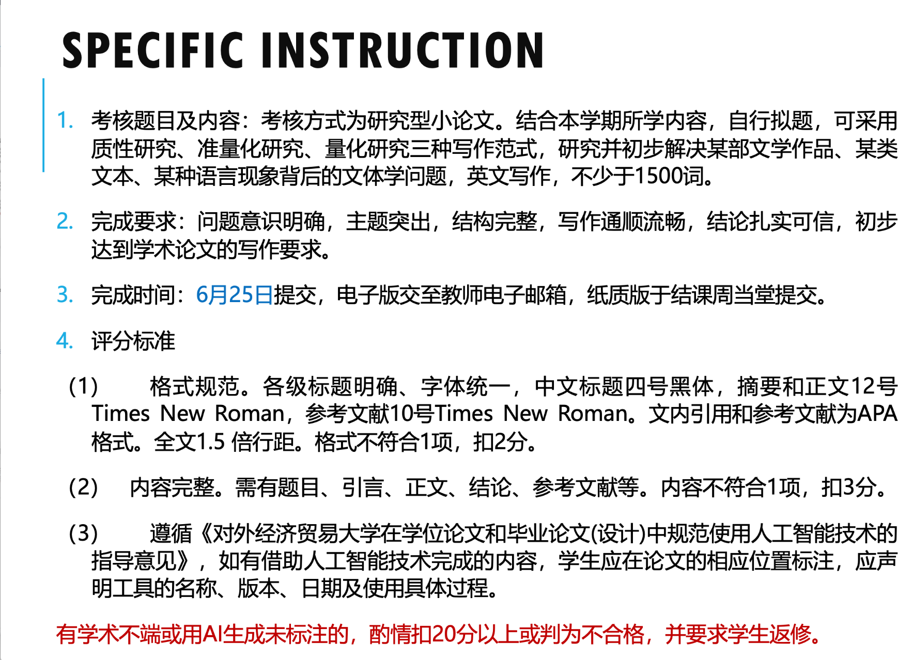

# 英语文体学

**待考据 · 李若珊**

[✏️ 编辑本页信息](/notebook-admin/public/offering/9)

| 字段 | 内容 |
|------|------|
| 课程代码 | ENG366 |
| 课程类别 | 专业方向课 |
| 任课教师 | 李若珊 |
| 学期 | 待考据 |
| 开课学院 | 英语学院 |
| 总课时 / 周课时 | 待补充 / 待补充 |
| 教学周数 | 待补充 |

[← 返回课程总览](index.md)

## 考核方式

无期中，有一次pre，内容为当周讲解内容，可见教学进度

期末论文要求

## 教材及参考资料

- [参考书] 文体学  BY 文旭，宋成方

## 留言 · 学习心得

欢迎留下你对这门课的真实感受、经验或建议。发布后可以随时修改或删除自己的留言。

留言加载中…

---

*最后更新：2026-07-20 · 信息来源：2023 级培养方案*
