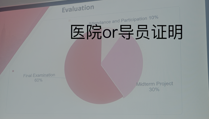
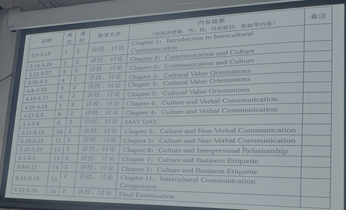

# 跨文化交际导论（英）

| 字段 | 内容 |
|------|------|
| 课程代码 | ENG817-2 |
| 课程类别 | 专业方向课 |
| 任课教师 | 史兴松 |
| 开课学院 | 英语学院 |

## 考核方式
平时-10%，期中-30%（其实没有期中考试，我感觉这部分主要是小组pre），期末-60%（闭卷考试、结课周考试）

## 教材及参考资料

## 教学进度

## 注意事项

### 考试题型

考试主要分为两部分：

- **客观题（40%）**
  - 判断题（True/False）
  - 概念理解题

- **主观题（60%）**
  - Case analysis（案例分析）
  - 观看视频并进行中外对比分析

### 复习建议
- 课堂内容整体比较轻松。
- 期末进行集中复习即可。
- 重点掌握：
  - 各个理论的基本含义；
  - 不同理论之间的区别；
  - 理论对应的英文名称及拼写。

> 注意：理论名称的英文拼写非常重要，考试中需要准确写出。

BY 24级好心人

---

*最后更新：2026-07-20 · 信息来源：2023 级培养方案*
