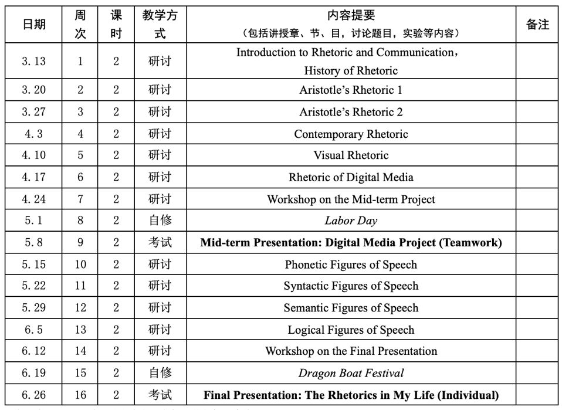

# 话语修辞与谈判

| 字段 | 内容 |
|------|------|
| 课程代码 | ENG821 |
| 课程类别 | 专业方向课 |
| 任课教师 | 董琳 |
| 开课学院 | 英语学院 |

## 考核方式

Homework (exercise from textbook): 20%。会有随机点名或随机提问

Mid-term: Digital Media Project (Teamwork)  use rhetorical theories or knowledge to create a digital media project (short-video, poster, social media article, etc.): 30%期中为小组制作相关作品并展示，老师着重看展示部分。期末为个人介绍某修辞现象，录屏展示8-10分钟左右。

Final: “The Rhetorics in My Life” Presentation (individual work) 50%

## 教材及参考资料

英文修辞学（第二版）张秀国著 清华大学出版社，北京交通大学出版社

Getting to YES negotiating an agreement without giving in BY ROGER FISHER & WILLIAM URY

## 教学进度

---

*最后更新：2026-06-17 · 信息来源：2023 级培养方案*
